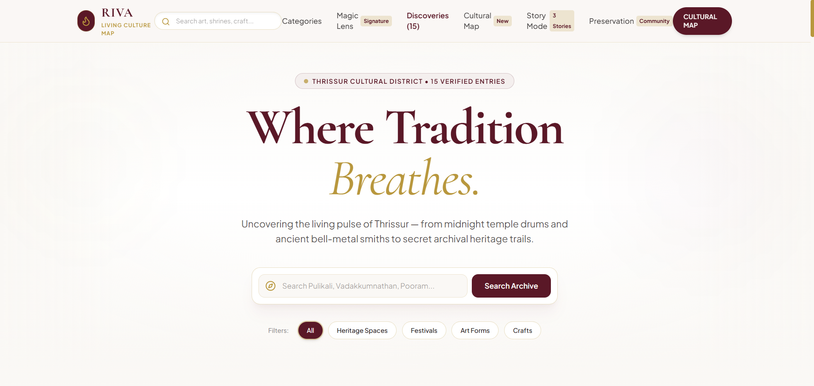
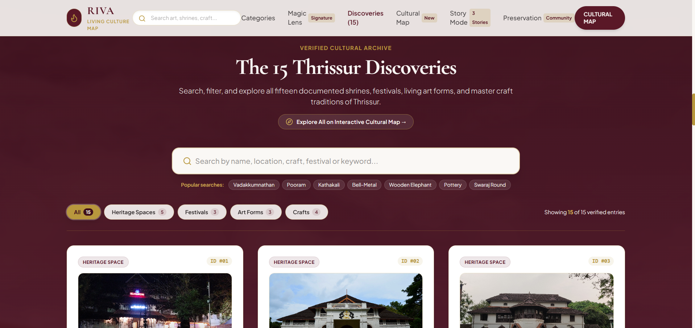
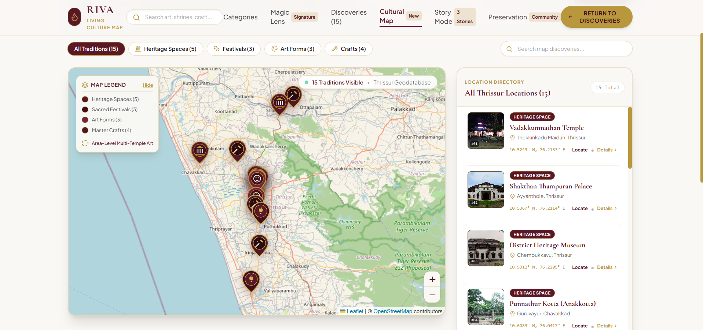
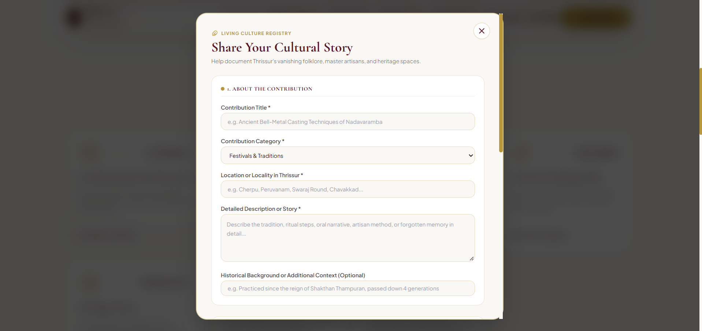
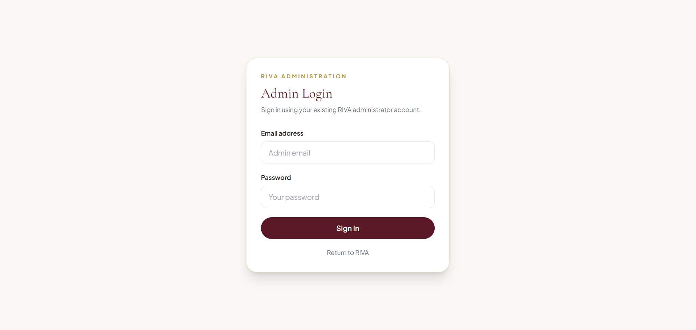
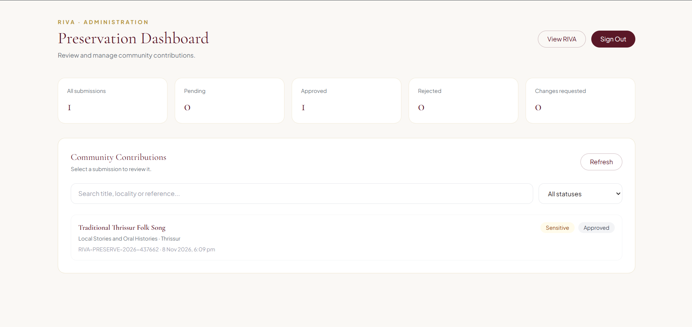
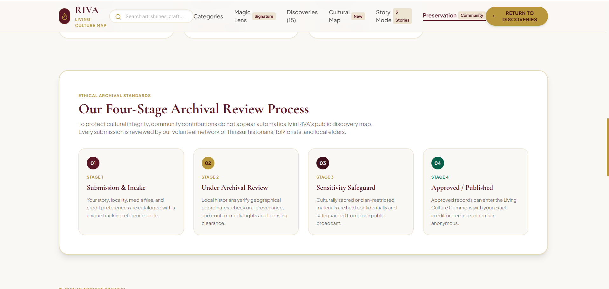

# RIVA – The Living Culture Map

**Discover. Explore. Preserve.**

## 1. Project Overview

RIVA – The Living Culture Map is a digital cultural heritage platform focused on documenting, exploring, and preserving the living culture of Thrissur, Kerala.

The platform brings together information about cultural places, traditions, art forms, festivals, historical stories, and local knowledge. It aims to connect people with their cultural roots through an interactive digital experience and encourage communities to participate in heritage preservation.

## 2. Problem Statement

Cultural heritage is often scattered across different sources, personal memories, local records, and community knowledge. Many traditions, stories, and lesser-known cultural places receive limited digital documentation and visibility.

There is a need for an accessible platform that brings this information together, makes local heritage easier to discover, and allows communities to contribute their knowledge towards its preservation.

## 3. Key Features

- **Cultural Exploration:** Discover cultural heritage and significant places across Thrissur.
- **Interactive Map Experience:** Explore cultural locations through a map-based interface.
- **Community Contributions:** Allow users to submit local stories, traditions, and cultural information.
- **Contribution Review:** Provide an admin dashboard to review, approve, reject, or request changes to submissions.
- **Cultural Documentation:** Organise information about local traditions, festivals, art forms, and historical places.
- **Community Participation:** Encourage people to take part in documenting and preserving their heritage.

## 4. Technology Stack

| Technology | Purpose |
|---|---|
| React | Frontend development |
| Vite | Development server and build tool |
| JavaScript | Application functionality |
| Tailwind CSS | Styling and responsive design |
| Supabase | Database and authentication |
| Git & GitHub | Version control and project hosting |
| Vercel | Planned deployment platform |

## 5. System Architecture

RIVA follows a client-server architecture.

- **Frontend:** React provides the user interface and handles user interactions.
- **Backend Services:** Supabase provides authentication and database services.
- **Database:** PostgreSQL stores cultural contribution details and their review status.
- **Admin Module:** Authenticated administrators manage and review community submissions.
- **Hosting:** Vercel is intended to host the frontend application.

### Architecture Flow

```text
             USER
               |
               v
       REACT FRONTEND
               |
               v
         SUPABASE
          /     \
         v       v
   AUTHENTICATION DATABASE
         |       |
         v       v
     ADMIN    CONTRIBUTIONS
    DASHBOARD   STORAGE
```

## 6. Installation & Setup Instructions

### Prerequisites

- Node.js and npm
- Git
- A Supabase account

### Steps

**1. Clone the repository**

```bash
git clone https://github.com/JoycePatious/The-Living-Culture-Map.git
```

**2. Navigate to the frontend directory**

```bash
cd The-Living-Culture-Map/frontend
```

**3. Install dependencies**

```bash
npm install
```

**4. Configure environment variables**

Create a `.env` file inside the `frontend` directory and add the required Supabase credentials.

**5. Start the development server**

```bash
npm run dev
```

**6. Build the application**

```bash
npm run build
```

## 7. Environment Variables

The project requires the following environment variables:

| Variable | Description |
|---|---|
| `VITE_SUPABASE_URL` | Supabase project URL |
| `VITE_SUPABASE_PUBLISHABLE_KEY` | Supabase publishable key |

Example `.env` file:

```env
VITE_SUPABASE_URL=your_supabase_project_url
VITE_SUPABASE_PUBLISHABLE_KEY=your_supabase_publishable_key
```

**Note:** Do not commit your `.env` file or expose secret keys in the repository.

## 8. Usage Instructions

1. Open the application in a web browser.
2. Explore the available cultural information and heritage sections.
3. Navigate through the platform to discover local cultural content.
4. Use the community contribution section to submit cultural information.
5. Administrators can access the admin dashboard through the `#admin` route.
6. Administrators can sign in and review submitted contributions, update their status, and provide review notes.

## 9. Demonstration Screenshots

## 9. Demonstration Screenshots

### 9.1 Homepage


### 9.2 Cultural Exploration


### 9.3 Heritage Map


### 9.4 Community Contribution Form


### 9.5 Admin Login


### 9.6 Admin Dashboard


### 9.7 Contribution Review


## 10. Team Members

MARIAM ANN GEORGE, JOYCE PATIOUS

## 11. Limitations & Future Scope

### Current Limitations

- Initial cultural coverage is focused on Thrissur.
- The availability of cultural information depends on community contributions and collected data.
- Uploaded contribution files are not yet integrated with permanent cloud storage.
- The platform's cultural database can be expanded with more verified information.

### Future Scope

- Expand cultural coverage to other districts and regions.
- Integrate more interactive map features.
- Add permanent image and document storage.
- Introduce multilingual support.
- Include audio, video, and oral-history documentation.
- Improve community participation and content verification.
- Develop more advanced search and filtering features.

## 12. License & Attribution

This project is developed for educational and cultural preservation purposes.

Third-party libraries, frameworks, images, and other external resources used in the project remain subject to their respective licenses and attribution requirements.

A formal open-source license can be added to the repository if the project is released for public reuse.

---

**RIVA – The Living Culture Map**

*Keeping culture alive, one story at a time.*